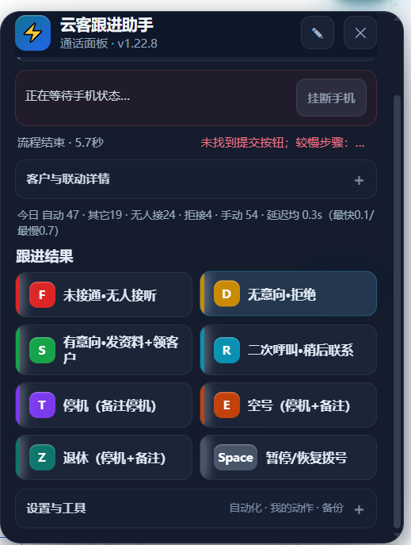

# 云客跟进助手 | Yunke CRM Follow-up Assistant

**非官方项目 / Unofficial project.** 为云客 CRM 页面提供浏览器扩展与 Android 手机联动源码，帮助查看通话状态、发起手机挂断请求、同步 CRM 页面，并快捷填写跟进结果。

觉得有用，欢迎在 GitHub 点 **Star**。完整源码包：[`yunke-follow-up-assistant-source-v1.24.0.zip`](./yunke-follow-up-assistant-source-v1.24.0.zip)。

## 界面预览

下图为扩展通话面板示例，截图来自 v1.22.8；当前桌面扩展源码为 v1.24.0。

## 功能

- 来电与拨号状态提示、快捷键控制。
- 通过手机 APK 请求挂断；未收到手机状态回执时，仅在确认还是同一通电话的情况下补发一次。
- 通话结束后同步 CRM 通话结果和跟进记录；页面暂时失配会自动重试，多个客户页签串行消费事件。
- 只有 CRM 明确确认提交后才移除待处理事件；提交状态不确定时保留待核对状态，不重复提交。
- CRM 客户无法唯一匹配时暂停跟进录入，避免写到错误客户。

## 源码

- `desktop-extension/`：Chrome Manifest V3 扩展源码，版本 1.24.0。
- `mobile-app/`：APK 反编译后的 smali 与资源源码，版本 1.56；没有附 APK 成品或签名材料。

## 安装桌面扩展

1. 下载并解压源码包。
2. 打开 Chrome `chrome://extensions`，开启“开发者模式”，加载解压后的 `desktop-extension/` 文件夹。
3. 按部署环境配置中转服务密钥。源码包不包含密钥；扩展从 CRM 页面 `localStorage` 读取 `yk_relay_access_key`。

源码包不包含中转密钥：扩展从 CRM 页面 `localStorage` 读取 `yk_relay_access_key`，手机 smali 使用 `YOUR_RELAY_ACCESS_KEY` 占位符，部署时填入自己的值。真实密钥不要提交到 Git。覆盖安装手机端仍需原应用的签名证书。

## 项目说明

仓库未包含客户名单、通话记录、APK 成品或签名材料。目前**未附开源许可证**，公开可见不等于授权复制、修改、再发布或商用。手机端反编译代码的授权范围也尚需确认。
