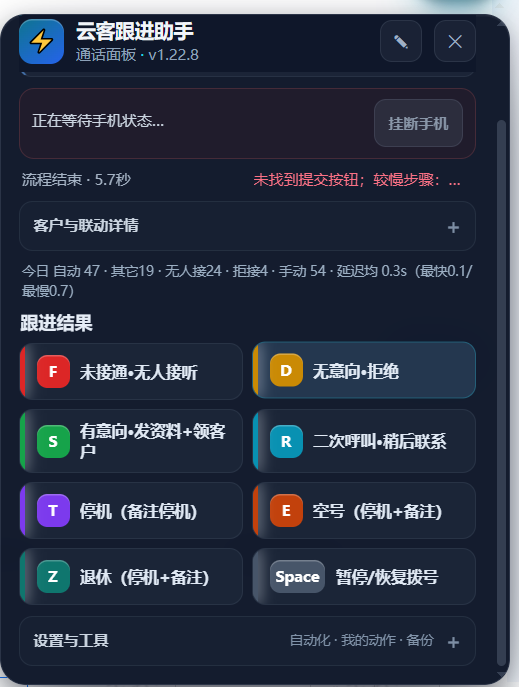

# 云客跟进助手 | Yunke CRM Follow-up Assistant

**非官方项目 / Unofficial project.** 为云客 CRM 页面提供浏览器扩展与 Android 手机联动源码，帮助查看通话状态、发起手机挂断请求、同步 CRM 页面，并快捷填写跟进结果。

觉得有用，欢迎在 GitHub 点 **Star**。桌面扩展最新可直接加载文件夹：[`云客跟进助手-v1.24.22-可直接加载`](./云客跟进助手-v1.24.22-可直接加载)。

## 界面预览

下图为扩展通话面板示例，截图来自 v1.22.8；当前桌面扩展源码为 v1.24.22。

## 功能

- 来电与拨号状态提示、快捷键控制。
- 通过手机 APK 请求挂断；未收到手机状态回执时，仅在确认还是同一通电话的情况下补发一次。
- 通话结束后同步 CRM 通话结果和跟进记录；页面暂时失配会自动重试，多个客户页签串行消费事件。
- 只有 CRM 明确确认提交后才移除待处理事件；提交状态不确定时保留待核对状态，不重复提交。
- 手机确认本通挂断后提前同步 CRM 页面；自动流程缩短客户结果按钮等待，减少先提交失败再同步重提。
- 同时消费手机 APK 上报的 `hangup` 和 `ended` 结束事件，避免已接通电话结束后不触发跟进流程。
- CRM 客户无法唯一匹配时暂停跟进录入，避免写到错误客户。
- v1.24.22 修复新版详情抽屉静态脱敏手机号识别，兼容 +86 和 0086；脱敏号码仍需前三位和末四位同时吻合。
- v1.24.22 在手机拨号开始时保存 CRM 当前客户的姓名与显示号码快照，支持回拨中间号关联到发起通话的客户；批量外呼先检查当前是否已是 500 条/页，只有不是时才切换，并等待列表稳定后全选、启动连续外呼。

## 连续外呼快捷启动

通话面板提供“500条/页 · 全选并拨打”（默认 F9，可点按键标签自定义）：先检查底部分页是否已是 500 条/页；不是才打开菜单选 500。等列表停止加载且行内容稳定后，点列表上方“选择全部”，确认出现“取消选择”，最后点云客“连续外呼”。任一步骤未确认都会停止，不会误拨。

## 待补录重试

未匹配挂断事件会在 24 小时内持续自动重试；只有唯一匹配到 CRM 客户后才会填写跟进。

## 源码

- `desktop-extension/`：Chrome Manifest V3 扩展源码，版本 1.24.22。
- `mobile-app/`：APK 反编译后的 smali 与资源源码，版本 1.56；没有附 APK 成品或签名材料。

## 使用前提与故障定位

- 桌面扩展和油猴脚本二选一。不要同时启用；如果页面控制台显示“已有一份在跑”，停用另一份旧脚本，再刷新 CRM 页面。先加载的旧版会占用运行位置。
- 手机和电脑必须能访问同一个中转服务。公开源码不含中转地址密钥；手机 APK 当前源码中的 `192.168.1.147:8787` 和 `YOUR_RELAY_ACCESS_KEY` 是部署配置，其他人需要改成自己的服务并重新构建、用匹配的签名安装 APK。仅下载扩展不能直接获得手机联动。
- 自动跟进需要 Chrome 中保留已登录的 CRM 页面，并保持电脑、手机和中转服务在线。页面关掉或浏览器退出后，浏览器端代码不能代替服务器运行。
- v1.24.22 会先把结束事件写入本地待办，再推进中转游标；本地存储失败时会停下来提示，不会先删除中转事件。旧事件按 ID 从早到晚分批取回。唯一客户匹配失败时保留待补录，避免把记录写给错误客户。
- 若面板显示“待补录”，事件已到电脑但客户匹配/提交仍需处理；若手机状态和挂断事件都没有更新，先检查 APK 到中转服务的网络、地址和密钥。这两种故障发生在不同环节。

## Tampermonkey 油猴脚本

脚本文件：[`yunke-follow-up-assistant.user.js`](./yunke-follow-up-assistant.user.js)。在 Tampermonkey 仪表盘选择“实用工具 → 从文件导入”，选中该文件并保存。使用油猴版时，停用 Chrome 扩展，避免两份脚本同时处理同一通电话。
## 安装桌面扩展

本次版本可直接加载目录：云客跟进助手-v1.24.22-可直接加载。在 Chrome 扩展管理页点击“加载已解压的扩展程序”，选择该文件夹；不要把 ZIP 拖进页面。

1. 打开 Chrome `chrome://extensions` 并开启“开发者模式”。
2. 点击“加载已解压的扩展程序”，选择仓库中的 `云客跟进助手-v1.24.22-可直接加载` 文件夹（或源码 `desktop-extension/` 文件夹）。不要把 ZIP 文件拖入页面。
3. 若扩展卡片显示旧版（例如截图中的 v1.24.13），停用旧版后加载新文件夹；确认面板版本显示 v1.24.22，再刷新 CRM 页面。油猴版也要停用。
4. 按部署环境配置中转服务密钥。扩展从 CRM 页面 `localStorage` 读取 `yk_relay_access_key`。

源码包不包含中转密钥：扩展从 CRM 页面 `localStorage` 读取 `yk_relay_access_key`，手机 smali 使用 `YOUR_RELAY_ACCESS_KEY` 占位符，部署时填入自己的值。真实密钥不要提交到 Git。覆盖安装手机端仍需原应用的签名证书。

## 项目说明

仓库未包含客户名单、通话记录、APK 成品或签名材料。目前**未附开源许可证**，公开可见不等于授权复制、修改、再发布或商用。手机端反编译代码的授权范围也尚需确认。
